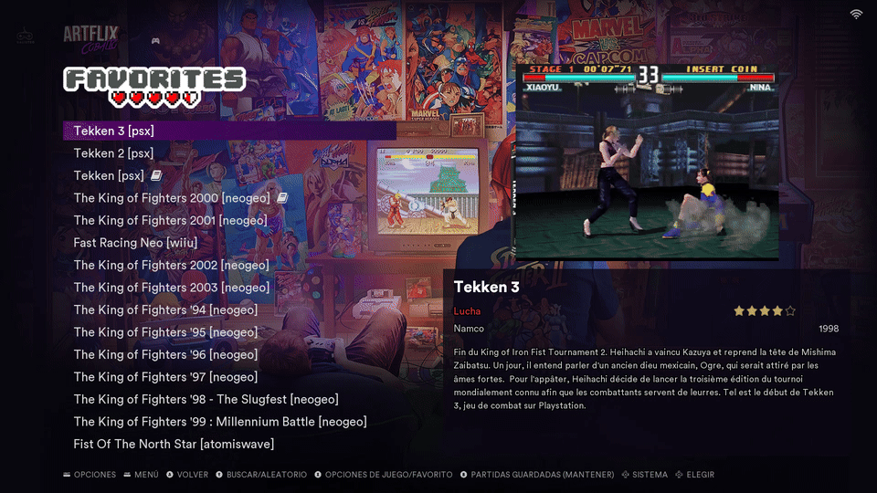
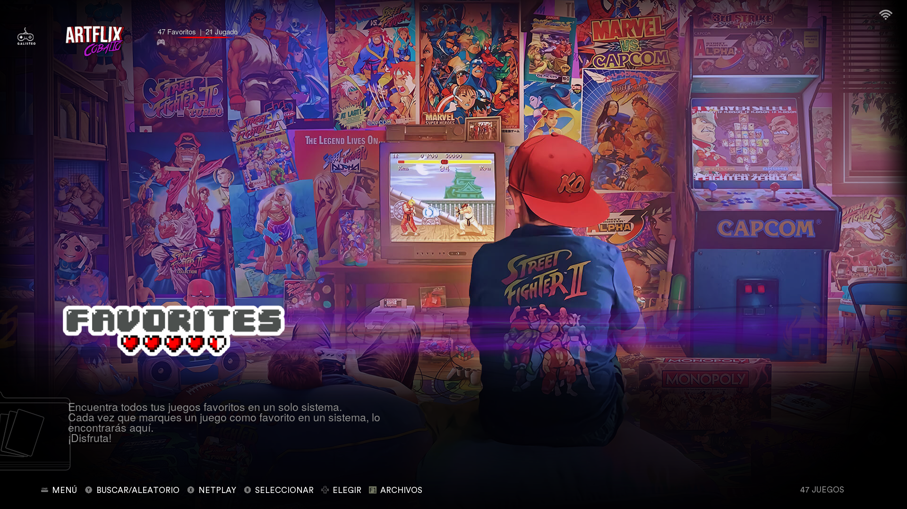
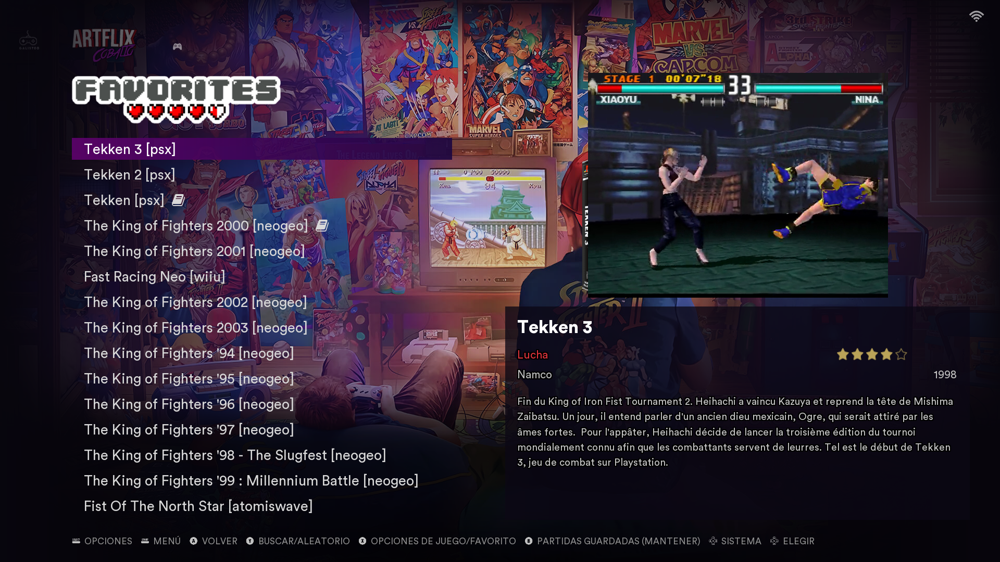

<div align="center">

# 🎬 Artflix-Cobalto · Alekfull · RS Groove

### Tema para EmulationStation · Batocera

**ARTFLIX-Cobalto con una lista de juegos nueva, hecha a la medida de su estilo**

*Modificación por **Richard Campos (RS Groove)***

[](CHANGELOG.md)
[](https://batocera.org)
[](#-compatibilidad)
[](LICENSE.md)



[Español](#-español) · [English](#-english)

</div>

---

## 🇦🇷 Español

### ¿Qué es?

**ARTFLIX-Cobalto** es uno de los temas más lindos para Batocera: arte exclusivo para más de 200 sistemas, con un estilo
inspirado en las plataformas de streaming. Este tema conserva **todo** eso y le cambia una sola cosa: **la pantalla que
ves al entrar a un sistema**.

En lugar de las vistas originales, trae una **lista de juegos clara y cómoda**, inspirada en la de **ALEKFULL NX**,
pero dibujada con los colores, las letras y el tinte violeta de Artflix-Cobalto, para que todo el tema se sienta como
una sola pieza.

### ✨ Qué cambia

| | ARTFLIX-Cobalto original | Esta versión |
| --- | --- | --- |
| **Pantalla de sistemas** | Artflix-Cobalto | ✅ La misma, sin cambios |
| **Al entrar a un sistema** | Vista «CoinOps Details» | 🎯 Lista de juegos nueva |
| **Lista de juegos** | Grilla de carátulas | Lista de texto grande y legible, debajo del logo del sistema (nada se encima) |
| **Selección** | — | Barra violeta con el degradado del menú de Artflix |
| **Detalle del juego** | — | Video o imagen, nombre grande, género en rojo Artflix, desarrollador, año, estrellas y descripción sobre un vidrio oscuro |
| **Fondo** | Arte del sistema | Arte del sistema + tinte violeta de Artflix + degradados para que el texto se lea siempre |

### 🖼️ Capturas

<div align="center">

**Pantalla de sistemas** (igual que Artflix-Cobalto)



**Lista de juegos** (lo nuevo)



</div>

### 📥 Instalación

**Opción 1 · Desde la PC, por la red**

1. Bajá el tema: botón verde **Code → Download ZIP**.
2. Descomprimilo y cambiale el nombre a la carpeta: `Artflix-Cobalto-Alekfull-RS-Groove`.
3. En el explorador de archivos entrá a `\\BATOCERA\share\themes` y copiá la carpeta ahí.
4. En Batocera: **Start → Ajustes de interfaz de usuario → Tema activo → Artflix-Cobalto-Alekfull-RS-Groove**.

**Opción 2 · Por SSH, directo en Batocera**

```bash
wget -O /tmp/rs-groove.zip https://github.com/RichardS-Groove/es-theme-artflix-cobalto-alekfull-rs-groove/archive/refs/heads/main.zip
unzip -q /tmp/rs-groove.zip -d /tmp
mv /tmp/es-theme-artflix-cobalto-alekfull-rs-groove-main /userdata/themes/Artflix-Cobalto-Alekfull-RS-Groove
rm /tmp/rs-groove.zip
```

Después reiniciá EmulationStation y elegí el tema en **Tema activo**.

> 💡 Para que la lista luzca, conviene tener los juegos con información e imágenes (scraper de Batocera) y, si es
> posible, los videos de los juegos.

### 🧩 Compatibilidad

- ✅ Probado en **Batocera 43.1**, en una tele de 75" a **1920×1080**.
- Pensado para pantallas **16:9**. En otras versiones o en RetroBat / EmuELEC no se probó todavía.
- Pesa unos **600 MB**: incluye todo el arte de Artflix-Cobalto.

### 🙏 Créditos

Este tema existe gracias al trabajo de otros. Todo el mérito del arte y del diseño original es de ellos:

- **ARTFLIX-Cobalto** — creado por **Fagner ([AlekFull](https://facebook.com/alekfull.arcade))** para las imágenes
  **[Galisteo](https://github.com/galisteogames) Cobalto** → [galisteogames/ARTFLIX-Cobalto](https://github.com/galisteogames/ARTFLIX-Cobalto)
- **ALEKFULL NX** — de **Fagner (AlekFull)**, inspiración para la lista de juegos → [fagnerpc](https://github.com/fagnerpc)
- **EmulationStation / Batocera** — [batocera.org](https://batocera.org)
- Logos y marcas: de sus respectivos dueños.
- Modificación: **Richard Campos (RS Groove)**.

El README original de ARTFLIX-Cobalto está en [`docs/README-ARTFLIX-COBALTO.md`](docs/README-ARTFLIX-COBALTO.md) y su
licencia completa en [`readme.txt`](readme.txt).

### 🔄 Al día con Artflix-Cobalto

Este repositorio revisa **todas las semanas** si los autores publicaron cambios en ARTFLIX-Cobalto. Si hay novedades,
se abre un aviso (*issue*) automáticamente para incorporarlas en una nueva versión. Base actual: ARTFLIX-Cobalto
`9cad3de`.

### 📜 Licencia

[Creative Commons **BY-NC-SA 4.0**](LICENSE.md), la misma del tema original:

- ✅ Podés compartirlo y modificarlo.
- 📝 Dando crédito a los autores, indicando los cambios y publicando con la misma licencia.
- 🚫 **Prohibido el uso comercial**: no se puede vender ni cobrar por él.

---

## 🇬🇧 English

### What is it?

**ARTFLIX-Cobalto** is one of the most beautiful Batocera themes, with exclusive artwork for 200+ systems. This
version keeps **everything** and changes one thing: **the screen you see when you enter a system**. Instead of the
original views, it brings a **clean, readable game list** inspired by **ALEKFULL NX**, redrawn with Artflix-Cobalto's
colors, fonts and purple tint so the whole theme feels like one piece.

### ✨ What's new

- Same Artflix-Cobalto **systems screen**, untouched.
- New default **game list**: large readable text placed below the system logo (no overlaps).
- Purple selection bar using Artflix's own menu gradient.
- Game details: video/image, big title, genre in Artflix red, developer, year, star rating and description on a dark
  glass panel.
- System artwork background with Artflix's purple overlay and gradients, so text is always readable.

### 📥 Install

Download the ZIP (**Code → Download ZIP**), rename the folder to `Artflix-Cobalto-Alekfull-RS-Groove`, copy it to
`/userdata/themes/` (`\\BATOCERA\share\themes` over the network), then select it in **Start → UI Settings → Theme
set**. Tested on **Batocera 43.1** at **1920×1080 (16:9)**.

### 🙏 Credits & license

All original artwork and design: **Fagner (AlekFull)** and **Galisteo** —
[ARTFLIX-Cobalto](https://github.com/galisteogames/ARTFLIX-Cobalto); game list inspired by **ALEKFULL NX**.
Modification by **Richard Campos (RS Groove)**. Licensed under [CC BY-NC-SA 4.0](LICENSE.md), like the original —
**no commercial use**.

<div align="center">

---

Hecho con 💜 para la comunidad retro · Made with 💜 for the retro community

</div>
